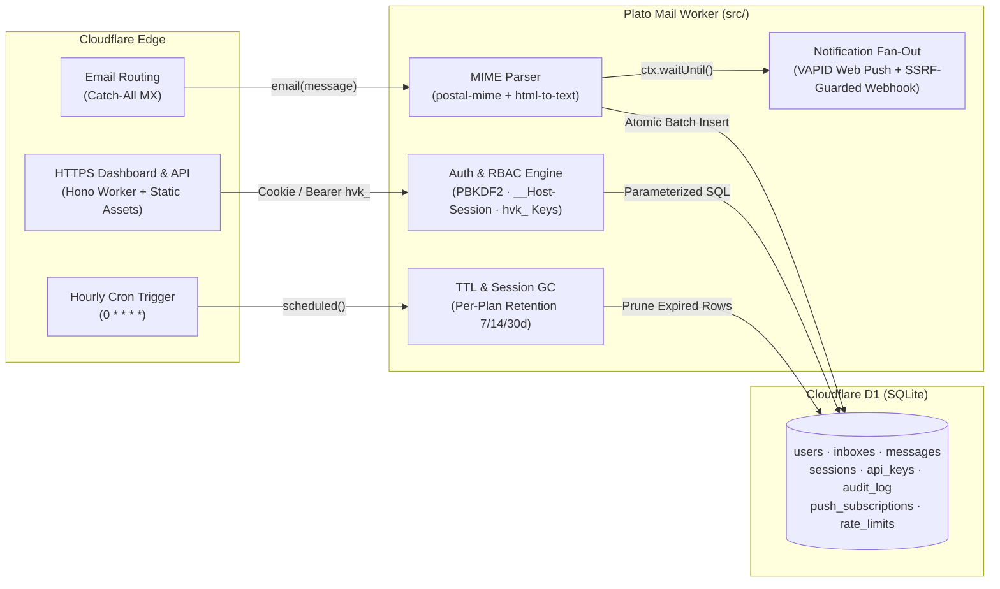

<div align="center">


# ✉️ Plato Mail

**Self-hosted multi-user temporary email on Cloudflare Workers, D1, and Email Routing.**  
Private disposable inboxes, 6 stackable role tiers, VAPID Web Push, and a token-authenticated REST API (`/api/v1`) for bots, scripts, and CI pipelines — with zero third-party mail relays in the loop.

[](https://github.com/aplatogg/Plato-Tempmail/actions/workflows/check.yml)
[](https://developers.cloudflare.com/workers/)
[](https://developers.cloudflare.com/d1/)
[](https://hono.dev/)
[](https://www.typescriptlang.org/)
[](https://datatracker.ietf.org/doc/html/rfc8292)
[](LICENSE)

[**Architecture**](#-architecture) · [**Features**](#-core-capabilities) · [**Role Tiers**](#-role-tier-matrix) · [**Quickstart**](#-quickstart) · [**Bot API (`/api/v1`)**](#-bot-api-apiv1) · [**Security Model**](#-security-architecture) · [**Docs**](#-documentation)

</div>

---

## 🏗️ Architecture

Plato Mail ingests inbound emails for your domain directly at the Cloudflare edge via **Email Routing**, parses MIME payloads in-memory with `postal-mime`, persists structured messages in **Cloudflare D1 (SQLite)**, and fans out real-time **VAPID Web Push** and **HTTPS Webhooks** without blocking delivery.



> **Note:** Every domain, Cloudflare account ID, and D1 database UUID in the tracked configuration is a synthetic placeholder. This repository ships source code, migrations, and automated verification suites only — zero live credentials or mailbox data.

---

## ✨ Core Capabilities

| Domain | Capabilities |
| :--- | :--- |
| **Multi-Inbox Workspace** | Instant random or custom local-part creation (`1–32` chars), address claims that prevent cross-user hijacking after deletion, favorites pinning, unread filter, and literal search across sender, display name, subject, and body. |
| **Safe MIME & OTP Reader** | Stream-bounded `2 MiB` raw MIME ingestion via `postal-mime`, inert text conversion via `html-to-text`, scriptless sandboxed HTML preview (`<iframe sandbox="">`), automatic OTP code candidate extraction, and attachment metadata inspection. |
| **6 Stackable Role Tiers** | Server-enforced RBAC bitmask (`Quark` → `Celestial`) controlling inbox creation quotas, deletion rights, message retention windows (`7`, `14`, or `30` days), Bot API key eligibility, and user administration. |
| **Bot Automation API (`/api/v1`)** | Stateless `hvk_<12 hex>_<48 hex>` bearer keys stored as `SHA-256` digests. Supports single or bulk inbox provisioning (`up to 50/call` via exact `localParts` or human-shaped Indonesian word-pair generators) and address-or-UUID path resolution. |
| **VAPID Web Push & Audio** | Background arrival alerts via `@block65/webcrypto-web-push` (RFC 8291/8292) even when the browser tab is closed, automatic `404/410` dead-endpoint pruning, and selectable WebAudio notification tones. |
| **SSRF-Hardened Webhooks** | Per-inbox HTTPS webhook forwarding with `3s` timeout, `redirect: "manual"` enforcement, and strict blocking of RFC 1918, loopback, link-local, NAT64 (`64:ff9b::`), 6to4 (`2002::`), and wildcard DNS rebinding domains (`*.nip.io`, `*.sslip.io`). |
| **Session & Credential Hygiene** | `__Host-plato_session` HTTP-only `SameSite=Strict` cookies, optional 30-day trusted-device sessions, per-device session listing & remote revocation, and atomic credential-version checks inside every SQL mutation. |

---

## 🛡️ Role Tier Matrix

Roles are stored as a bitmask and can be combined per account (except `Quark`, which is exclusive and automatically binds a single `username@domain` inbox):

| Role Tier | Inbox Quota | Message Retention | Can Delete Inboxes | Bot API Keys (`hvk_`) | Administrative Scope |
| :--- | :---: | :---: | :---: | :---: | :--- |
| **`Quark`** | `1` (`username@domain`) | **7 days** | ❌ | ❌ | Assigned mailbox only |
| **`Voyager`** | `6` total | **7 days** | ❌ | ❌ | Standard member workspace |
| **`Stardust`** | `100` / calendar year | **14 days** | ❌ | ✅ (`up to 20`) | Automation & extended quota |
| **`Astral`** | Unlimited (up to global cap) | **30 days** | ✅ | ✅ (`up to 20`) | Read-only technical diagnostics + delete members |
| **`Cosmos`** | Unlimited (up to global cap) | **30 days** | ✅ | ✅ (`up to 20`) | Create, reset, and assign `Quark`–`Astral` accounts |
| **`Celestial`** | Unlimited (up to global cap) | **30 days** | ✅ | ✅ (`up to 20`) | Full RBAC control, audit log, read-only inbox inspection |

---

## 🚀 Quickstart

### Prerequisites
- **Node.js 22+** & `npm`
- A **Cloudflare Account** with a domain on Cloudflare DNS (for production deployment; local development runs entirely offline with Wrangler's local D1 simulator)

### 1. Local Development (`127.0.0.1:8787`)

```bash
# Install locked dependencies
npm ci

# Generate ignored .dev.vars with a random-salted local admin / admin verifier
npm run bootstrap:local

# Apply all 15 D1 SQLite migrations locally
npm run db:local

# Start local Cloudflare Worker & dashboard
npm run dev
```

Open **`http://127.0.0.1:8787`** and sign in with `admin` / `admin` (local synthetic fixture only).

### 2. Production Deployment

1. Copy the template config to your gitignored private file:
   ```bash
   cp wrangler.jsonc wrangler.local.jsonc
   ```
2. Provision a D1 database (`npx wrangler d1 create plato-tempmail-db`) and fill `account_id`, `database_id`, `routes`, `MAIL_DOMAIN`, and `PUBLIC_ORIGIN` inside `wrangler.local.jsonc`.
3. Run the offline preflight validator, apply remote D1 migrations, set your owner password verifier secret, and deploy:
   ```bash
   npm run preflight
   npm run db:remote
   npm run password:hash
   npx wrangler secret put AUTH_PASSWORD_HASH --config wrangler.local.jsonc
   npm run deploy
   ```

See [**`docs/deployment.md`**](docs/deployment.md) for the complete Cloudflare Email Routing and Web Push VAPID setup guide.

---

## 🤖 Bot API (`/api/v1`)

Mint an API key from the top-right **API** button in the dashboard (`Stardust` role or higher). The raw `hvk_<12 hex>_<48 hex>` secret is displayed **once** and stored only as a `SHA-256` hash.

All `/api/v1/inboxes/:id` routes accept **either the inbox UUID or the URL-encoded email address** (e.g. `budi%40example.com`).

```bash
export PLATO_KEY="hvk_<12_hex>_<48_hex>"

# 1. Inspect caller identity & domain
curl -s -H "Authorization: Bearer $PLATO_KEY" \
  https://mail.example.com/api/v1/me

# 2. Bulk-create 5 human-shaped inbox addresses (e.g. titikwiduri54@example.com)
curl -s -X POST -H "Authorization: Bearer $PLATO_KEY" \
  -H "Content-Type: application/json" \
  -d '{"count": 5}' \
  https://mail.example.com/api/v1/inboxes/bulk

# 3. Bulk-create exact local-parts with zero random suffix
curl -s -X POST -H "Authorization: Bearer $PLATO_KEY" \
  -H "Content-Type: application/json" \
  -d '{"localParts": ["alert-bot", "ci-runner"]}' \
  https://mail.example.com/api/v1/inboxes/bulk

# 4. Poll unread messages by email address or inbox UUID
curl -s -H "Authorization: Bearer $PLATO_KEY" \
  "https://mail.example.com/api/v1/inboxes/alert-bot%40example.com/messages?unread=1"
```

### `/api/v1` Endpoint Summary

| Method | Endpoint | Description |
| :---: | :--- | :--- |
| `GET` | `/api/v1/me` | Principal identity, `roles`, `mailDomain`, `retentionDays` |
| `GET` | `/api/v1/inboxes` | List owned inboxes (`up to 2,000` with unread & arrival counters) |
| `POST` | `/api/v1/inboxes` | Create single inbox (`{"localPart": "name"}` or random) |
| `POST` | `/api/v1/inboxes/bulk` | Provision `1–50` inboxes via `{"localParts": [...]}` or `{"count": N, "prefix"?: "..."}` |
| `PATCH` | `/api/v1/inboxes/:id` | Toggle favorite (`{"favorite": true}`) by UUID or email address |
| `DELETE` | `/api/v1/inboxes/:id` | Delete inbox (`Astral` / `Cosmos` / `Celestial`) |
| `GET` | `/api/v1/inboxes/:id/messages` | Paginated message summaries (`?filter=unread`, `?q=...`, `?cursor=...`) |
| `POST` | `/api/v1/inboxes/:id/read-all` | Mark all messages in inbox as read |
| `DELETE` | `/api/v1/inboxes/:id/messages` | Clear all messages in inbox |
| `GET` | `/api/v1/messages/:id` | Full message detail (`body`, `html`, `attachments`) |
| `PATCH` | `/api/v1/messages/:id` | Toggle message read state (`{"isRead": true}`) |
| `DELETE` | `/api/v1/messages/:id` | Delete single message |

Full API specification: [**`docs/API.md`**](docs/API.md).

---

## 🔒 Security Architecture

- **Transactional Freshness Predicate**: Every SQL read and write binds `freshSession(c)` inside the D1 statement itself. Password rotation, role changes, or key revocation invalidate in-flight requests atomically with `409 CREDENTIALS_CHANGED`.
- **Constant-Time PBKDF2-SHA256**: Passwords use `100,000` iterations of WebCrypto PBKDF2-SHA256 with a 16-byte random salt and `crypto.subtle.timingSafeEqual`. Unknown usernames still execute a full KDF derivation to prevent timing enumeration.
- **Strict Content Security Policy**: Responses carry `default-src 'none'; frame-ancestors 'none'; base-uri 'none'`, `X-Frame-Options: DENY`, `X-Content-Type-Options: nosniff`, `Referrer-Policy: no-referrer`, and `Cache-Control: no-store`.
- **Untrusted HTML Isolation**: HTML emails are rendered exclusively inside `<iframe sandbox="">` without `allow-scripts` or `allow-same-origin`.
- **Automated Secret Guard**: `tests/secrets.test.mjs` scans the git index in CI and fails the build if a real Cloudflare account ID, D1 UUID, API token (`cfut_`), bot key (`hvk_`), or PBKDF2 verifier is ever tracked.

To report a security vulnerability privately, see [**`SECURITY.md`**](SECURITY.md).

---

## 🧪 Verification & Tooling

| Command | Description |
| :--- | :--- |
| `npm test` | Run all **518 Vitest unit & Worker D1 tests** across 19 suites |
| `npm run test:tooling` | Run **27 Node tooling, preflight, secret-guard, and client-guard tests** |
| `npm run test:e2e` | Run Playwright desktop & mobile browser E2E suite |
| `npm run test:integration` | Run Playwright against a live local Wrangler Worker harness |
| `npm run typecheck` | Strict TypeScript check (`src/` + `tests/`) |
| `npm run lint` | Biome formatter and linter check |
| `npm run build:ci` | Wrangler dry-run bundle verification against `wrangler.jsonc` |

---

## 📚 Documentation

| Document | Contents |
| :--- | :--- |
| [**`docs/deployment.md`**](docs/deployment.md) | Step-by-step Cloudflare Workers, D1, DNS, and Email Routing setup |
| [**`docs/API.md`**](docs/API.md) | Bot API (`/api/v1`) reference and `curl` recipes |
| [**`docs/recovery.md`**](docs/recovery.md) | D1 backup, disaster recovery, and domain migration runbook |
| [**`docs/verification.md`**](docs/verification.md) | Pre-release verification matrix |
| [**`THIRD_PARTY_NOTICES.md`**](THIRD_PARTY_NOTICES.md) | Open-source dependency attributions |

---

<div align="center">

**[MIT License](LICENSE)** · Built by **[@aplatogg](https://github.com/aplatogg)**

</div>
